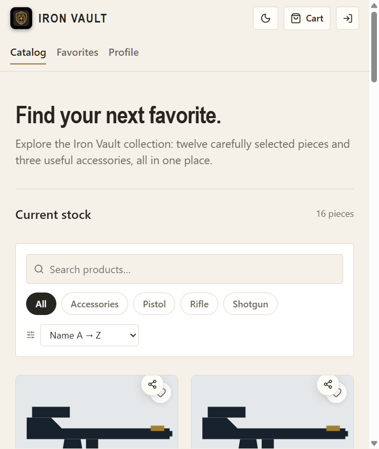

# Laporan Implementasi Fitur Iron Vault

**Link aplikasi Vercel:** https://gunshopapp.vercel.app/  
**Source code:** repository GitHub `sharontabitha/GunshopApp`.

## Share link katalog

Setiap kartu dan halaman detail memiliki tombol Share. Tombol membentuk URL berisi ID produk (`?product=...`), lalu memakai Web Share API pada perangkat yang mendukung atau menyalin tautan ke clipboard. Saat tautan dibuka, katalog memilih item yang ID-nya cocok dan langsung membuka detailnya. Implementasi ada di [`ShareButton.jsx`](./src/components/common/ShareButton.jsx), [`GunCard.jsx`](./src/components/gun/GunCard.jsx), [`GunDetail.jsx`](./src/components/gun/GunDetail.jsx), dan [`Catalog.jsx`](./src/pages/Catalog.jsx). Ini membuat halaman produk bisa dibagikan langsung tanpa meminta penerima mencari ulang katalog.

## Lazy load

Gambar pada kartu katalog memakai `loading="lazy"` dan `decoding="async"`, sehingga browser menunda unduhan gambar di luar viewport dan mendekodenya secara asynchronous. Foto tambahan pada galeri detail juga lazy-loaded; gambar utama detail dimuat dengan prioritas tinggi setelah halaman produk dibuka. Cek implementasi di [`GunCard.jsx`](./src/components/gun/GunCard.jsx) dan [`GunDetail.jsx`](./src/components/gun/GunDetail.jsx). Di DevTools Network, filter `Img`, reload, lalu scroll katalog: permintaan gambar seharusnya muncul bertahap ketika kartu mendekati layar.

## Query dan image caching

Hasil query produk disimpan di cache memori selama 30 detik dan permintaan identik yang berjalan bersamaan berbagi request yang sama. Cache dibersihkan setelah operasi tambah, edit, arsip, pulihkan, atau hapus supaya tampilan tidak memakai hasil lama. Service worker memakai strategi Cache First untuk berkas gambar, membatasi cache hingga 120 gambar selama 30 hari. Implementasi berada di [`gunService.js`](./src/services/gunService.js) dan [`vite.config.js`](./vite.config.js). Cache browser dapat diperiksa melalui kolom Size di Network; permintaan berikutnya dapat ditandai `disk cache` atau dilayani service worker.

## Profile: draft, edit profil, About, dan Contact

About dan Contact sekarang menjadi section di halaman Profile. Profile memiliki halaman edit terpisah yang dibuka dengan tombol Edit profile, dan section Drafts menampilkan draft form katalog tersimpan di browser, dengan aksi melanjutkan atau menghapus draft. Bagian overview merangkum data akun dan jumlah favorit, draft, serta katalog arsip. Implementasi halaman ada di [`ProfilePage.jsx`](./src/pages/ProfilePage.jsx); tautan navbar ada di [`Header.jsx`](./src/components/Header.jsx), sedangkan penyimpanan draft ada di [`draftStorage.js`](./src/utils/draftStorage.js). Draft form lokal tetap tersedia pada browser/perangkat yang menyimpannya, sehingga belum tersinkron antarperangkat.

## Arsip dan pemulihan katalog

Aksi hapus dari katalog kini mengarsipkan record dengan `archived_at`, sehingga item tidak tampil di katalog aktif. Section Archive pada Profile menyediakan aksi Restore dan Delete permanently; penghapusan permanen hanya tersedia untuk record yang sudah diarsipkan. Query katalog aktif dan arsip dipisahkan oleh [`gunService.js`](./src/services/gunService.js), dengan alur UI di [`Catalog.jsx`](./src/pages/Catalog.jsx) dan [`ProfilePage.jsx`](./src/pages/ProfilePage.jsx). Perubahan ini memberi kesempatan memulihkan data yang terhapus secara tidak sengaja.

## Review: edit, hapus, like, dan dislike

Pemilik review dapat mengedit rating/komentar atau menghapus review sendiri. Pengguna lain dapat memberi like atau dislike; menekan pilihan yang sama kembali menghapus vote, sementara memilih arah lain mengganti vote. Supabase RLS membatasi edit/hapus review dan vote pada pemilik akun. Kode UI/API berada di [`GunDetail.jsx`](./src/components/gun/GunDetail.jsx) dan [`reviewService.js`](./src/services/reviewService.js); tabel, kebijakan akses, dan Storage bucket didefinisikan di [`assignment-features.sql`](./supabase/assignment-features.sql). Aksi ini memerlukan sesi login dan skema migrasi Supabase telah diterapkan.

## Banyak gambar per katalog

Form tambah dan edit katalog menerima hingga lima gambar JPG, PNG, atau WebP dengan ukuran maksimal 5 MB per file. File disimpan di Supabase Storage, URL-nya dicatat pada `image_urls`, dan detail produk menyediakan thumbnail untuk memilih gambar utama yang ditampilkan. Implementasi form ada di [`CreateGunPage.jsx`](./src/pages/CreateGunPage.jsx) dan [`EditGunPage.jsx`](./src/pages/EditGunPage.jsx); upload dikerjakan oleh [`uploadService.js`](./src/services/uploadService.js), sedangkan normalisasi data ada di [`gunService.js`](./src/services/gunService.js). Jika Storage menolak upload, aplikasi menunjukkan error, bukan berpura-pura bahwa file sudah tersimpan.

## Setup database sebelum fitur live

Migrasi [`assignment-features.sql`](./supabase/assignment-features.sql) sudah berhasil dijalankan di Supabase SQL Editor. Migrasi menambah kolom arsip/draft/multi-image, tabel vote review dan kebijakan RLS, serta bucket `guns` dengan aturan akses administrator. Dengan skema baru, fitur katalog dapat meminta kolom arsip dan multi-image dari database.

## Gambar hasil program

Berikut tangkapan layar katalog dari deployment Vercel saat ini:

Untuk bukti lazy load dan cache, ambil tangkapan layar DevTools Network dengan filter Img sebelum dan sesudah scroll; gambar-gambar tersebut memperlihatkan unduhan bertahap dan cache browser.
